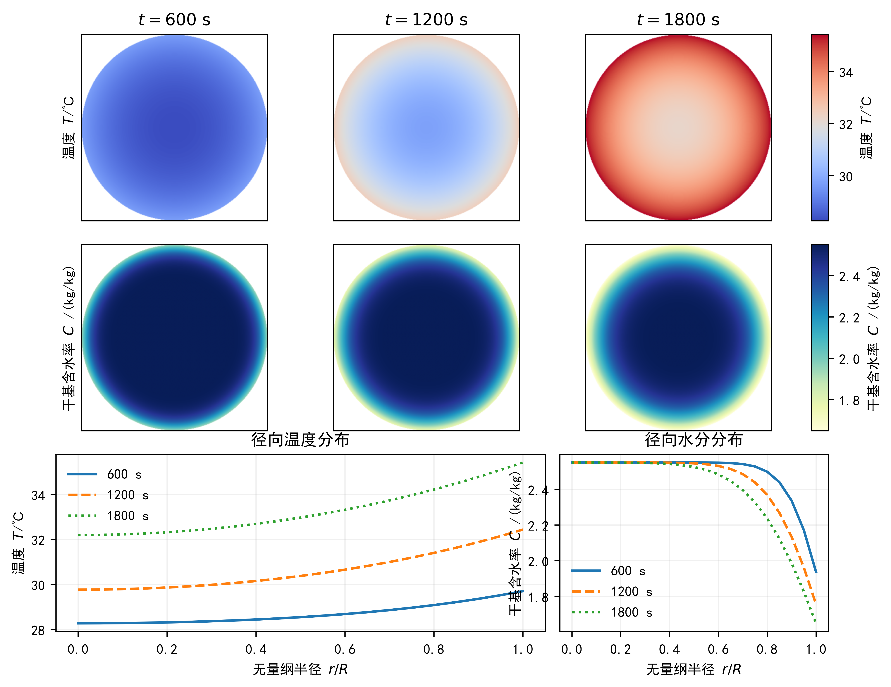
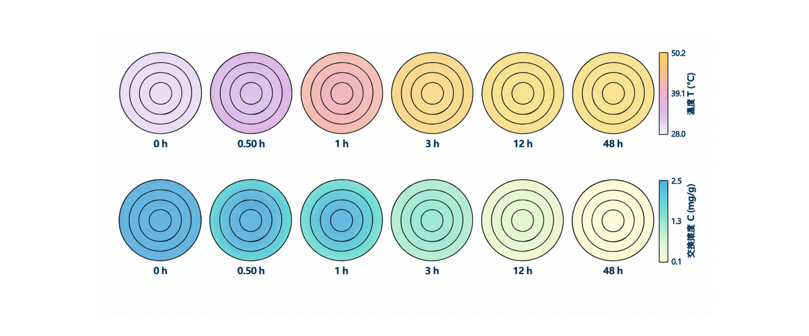
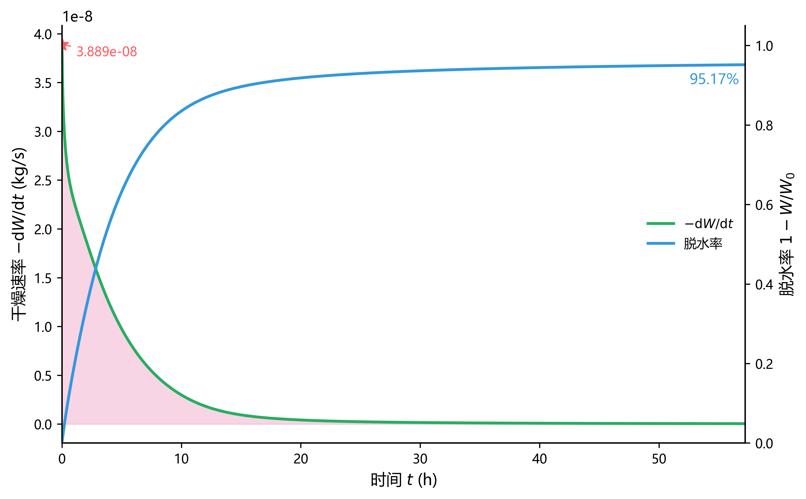
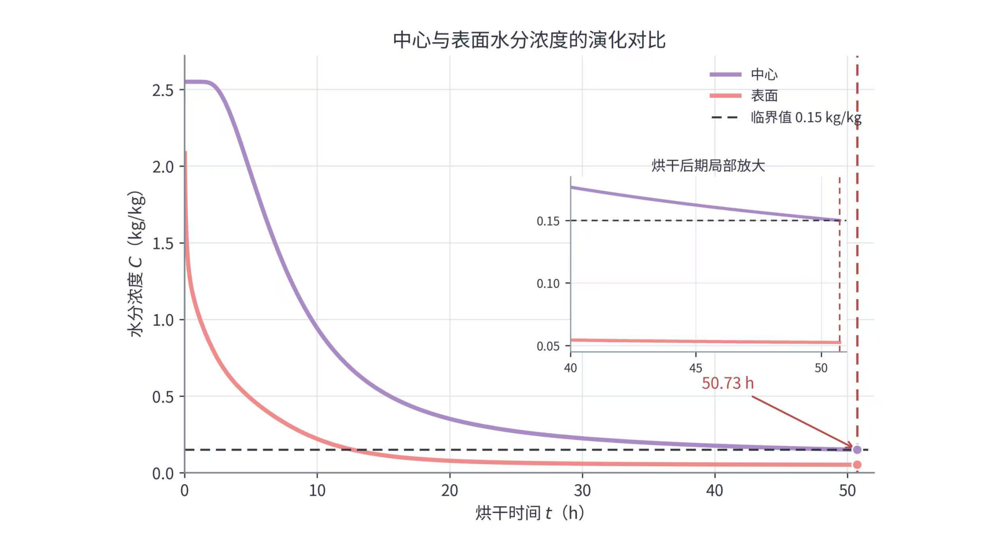

# 药材烘干过程热质耦合与非线性扩散模型研究（2026 国赛 A 题）

## 引言

这是一个围绕中药材热风烘干展开的数学建模作品。我们把药材内部的温度场和水分场放在同一个模型里，回答四个问题：预热阶段温湿度怎么变、整个烘干过程怎么演化、什么时候达到含水率要求、以及考虑药材尺寸收缩后烘干时间是多少。

仓库里放着完整的 Python 求解代码、验证脚本、论文图表复现代码和论文 PDF。希望它能帮你做到两件事：准备数学建模竞赛时，看到一个从模型假设、数值离散到结果验证的完整流程；需要处理热质耦合或移动边界问题时，直接拿走一套可运行的代码骨架。

> 题目：2026 年全国大学生数学建模竞赛 A 题《药材的烘干问题》。

论文全文：[药材烘干过程热质耦合与非线性扩散模型研究](paper/药材烘干过程热质耦合与非线性扩散模型研究.pdf)

## 设计理念

- **先保证守恒**：空间离散采用有限体积法（FVM），水分总量守恒到机器精度（实测相对误差约 `1e-14`）。有限差分在变系数下不自动守恒，这是选 FVM 的主要原因。
- **把非线性处理干净**：水分扩散系数 \(D(C,T)\) 在给定含水率范围内跨越约 4 个数量级，界面系数采用 Kirchhoff 积分平均；热湿耦合方程用 Picard 迭代求解。
- **结果要能被质疑**：每个问题都有独立验证，模型验证入口统一在 `src/`（求解器仍在 Q1–Q4；`Q1/data_prep.py` 是数据预处理）；覆盖网格/时间收敛、基线对比、灵敏度分析、误差预算和独立实现交叉验证。
- **可复现**：固定随机种子，记录输入文件 sha256；论文中的主要结果图（图4、图5、图10、图11 等）可由仓库内代码复现，示意图和部分结果图未包含在仓库代码中。

## 内容主体

### 四个问题与结果

| 问题        | 模型要点                                                             | 主要结果                                              |
| ----------- | -------------------------------------------------------------------- | ----------------------------------------------------- |
| Q1 预热阶段 | 一维径向轴对称、Fourier 导热 + Fick 扩散、Robin 边界、FVM + 后向欧拉 | `result1.xlsx`：0–1800 s 内不同半径位置的温度与含水率 |
| Q2 全过程   | 变物性非线性热湿耦合、Kirchhoff 变换、Picard 迭代                    | `result2.xlsx`：预热 + 恒温干燥两阶段的温度场与水分场 |
| Q3 烘干终点 | 以内部最大含水率首次低于 `0.15 kg/kg` 为判据，时间层线性插值定位     | **57.2107 h**，`result3.xlsx`                         |
| Q4 尺寸收缩 | 引入材料坐标与移动边界，考虑半径随时间收缩                           | **50.7458 h**，`result4.xlsx`                         |

### 模型要点

药材长径比 \(L/R = 12.5\)，端面面积只占总换热面积约 7.4%，因此忽略轴向输运，简化为一维径向轴对称问题。

Q2 的控制方程如下；Q1 是其常物性简化形式。

$$
\rho(C)c_p(C)\frac{\partial T}{\partial t}
=\frac{1}{r}\frac{\partial}{\partial r}\left(rk(C)\frac{\partial T}{\partial r}\right),
\qquad
\frac{\partial C}{\partial t}
=\frac{1}{r}\frac{\partial}{\partial r}\left(rD(C,T)\frac{\partial C}{\partial r}\right)
$$

表面采用 Robin 边界：对流换热系数 \(h=25\ \mathrm{W/(m^2\cdot K)}\)，对流传质系数 \(h_m=8\times10^{-7}\ \mathrm{m/s}\)。Q1 使用附录 2 的恒定物性，Q2、Q3 使用附录 3 的变物性经验公式，Q4 使用附录 4 的公式。

Q3 在同一模型上延长时域，终点判据为

$$
\max_{r} C(r,t) < 0.15\ \mathrm{kg/kg}
$$

Q4 引入材料坐标 \(\xi=r/R(t)\)，把随时间收缩的计算域映射到固定域，再求解带移动边界的非线性水分扩散模型。

### 验证

- **质量守恒**：Q2/Q3 全程水分总量相对误差约 `1e-14`。
- **网格与时间收敛**：`src/convergence_q1.py`、`src/window_error_q1.py`、`src/verify_q4_convergence.py`、`src/verify_q2_convergence.py`。
- **基线对比**：`src/verify_q4_baseline.py` 对比粗网格、不同界面系数处理与不同边界口径；`src/verify_q2_compare.py` 做 Q2 的退化回归与形式对比。
- **灵敏度分析**：`src/verify_q4_sensitivity.py`、`src/verify_q2_sensitivity.py` 扰动关键参数，检查烘干时间的变化方向与量级。
- **误差预算**：`src/verify_q2_error_budget.py` 汇总 Q2 的离散/模型/数据/参数四类误差；冻结结果见 `results/q2_error_budget.json`。
- **独立校验**：`src/independent_check_q1_temp.py` 用 Bessel 级数 + Duhamel 卷积独立计算温度场；`src/verification_q1.py` 做 Q1 综合验证；`src/q3_selftest.py` 用合成数据对 Q3 的定位、边界情况和产物格式做自测。

### 快速开始

开发环境为 Python 3.13，依赖版本见 `环境配置/requirements.txt`：

```bash
pip install -r 环境配置/requirements.txt
```

运行四个问题：

```bash
python Q1/run_q1.py
python Q2/problem2.py
python Q3/problem3.py
python Q4/run_q4.py
```

重新生成论文图表：

```bash
python 图表代码/误差分析图/run_all.py
python 图表代码/图9图10绘图代码/run_all.py
python "图表代码/论文图表代码包/图4_温度场与水分场时空演化.py"
python "图表代码/论文图表代码包/图5_表面热通量与传质通量演化.py"
```

> 图表代码沿用开发时的内部编号，和论文图号可能差一位。已确认 `figure9_hovmoller.py` 生成的是论文图10（水分分布的时空演化），`figure10_drying_rate.py` 生成的是论文图11（干燥水率-累计脱水率曲线）；误差分析图的“图1/图2”是子包内部编号，不是论文图号。其他图请以论文图题为准。
>
> `误差分析图/run_all.py` 的指标直接写在脚本里（`图1_整体误差指标.py:7-9`），用于复现图表版式，不会随新结果自动重算。

Q1、Q4 的结果写入仓库根的 `results/`；Q2、Q3 分别写入 `Q2/output/`、`Q3/output/`（部分结果 JSON 另写到各自的 `figures/`）。脚本用相对路径读取 `附件/`，从仓库根目录运行即可。

根目录的 `result1.xlsx` ~ `result4.xlsx` 是最终交付副本，不会随脚本运行自动更新。

### 复现验证

#### Q1

```bash
python src/convergence_q1.py
python src/verification_q1.py
python src/window_error_q1.py
python src/independent_check_q1_temp.py
```

会重跑数值解，耗时较长。

#### Q2

```bash
python src/verify_q2_compare.py --help
python src/verify_q2_convergence.py --help
python src/verify_q2_error_budget.py --help
python src/verify_q2_sensitivity.py --help
```

> Q2 的完整复跑依赖开发期的 `results/q2_parts/` 中间缓存（完整目录约 719MB，未入库）和当时的输入数据版本。仓库保留的是冻结的验证结果 JSON；这些脚本适合审阅与追溯，不保证在当前精简仓库里一键跑完全部算例。

#### Q3

```bash
python src/q3_selftest.py
```

当前版本 54 项检查全部通过，输出写到 `results/_q3_selftest_out/`（已忽略）。

#### Q4

```bash
python src/verify_q4_baseline.py
python src/verify_q4_compare.py
python src/verify_q4_convergence.py
python src/verify_q4_sensitivity.py
```

会重跑数值解，耗时较长。完整说明见 `src/README.md`。

### 代表性结果图

下面按 Q1–Q4 各放一张代表性结果。Q1、Q3 由仓库代码生成；Q2、Q4 直接从论文 PDF 提取（论文图7、图14），用于展示结果全貌。

**Q1｜温度场与水分场时空演化**



**Q2｜温度场与含水率场的截面演化**



**Q3｜干燥水率-累计脱水率曲线**



**Q4｜中心与表面水分浓度的演化对比**



说明：Q2/Q4 两张是从论文 PDF 提取的原图，不是仓库代码生成；论文全文见 `paper/`。

### 团队分工

我们团队三个人的分工：

- 代码、图表与 AI skill 迭代：[@AR-firefly](https://github.com/AR-firefly)（skill：[math-modeling-skill](https://github.com/AR-firefly/math-modeling-skill)）
- 论文撰写与图表优化：[@rosalingju](https://github.com/rosalingju)
- 建模思路统筹与方案验证：[@haoyuany116-dotcom](https://github.com/haoyuany116-dotcom)

## 文件结构

```text
math-modeling-2026-a-herb-drying/
├─ Q1/                      # 问题一：预热阶段一维径向热质模型
├─ Q2/                      # 问题二：变物性非线性热湿耦合模型
├─ Q3/                      # 问题三：烘干终点判定
├─ Q4/                      # 问题四：考虑尺寸收缩的移动边界模型
├─ src/                     # Q1–Q4 验证入口（求解器仍在各自目录）
├─ 图表代码/                # 论文图表、误差分析图、论文原图与复现说明
├─ 数据台账/                # 参数、数据事实与跨问题一致性记录
├─ 附件/                    # 官方附件数据（附件1/2/3）
├─ results/                 # 最终结果与 Q1–Q4 验证 JSON
├─ 环境配置/                # requirements.txt 与环境说明
├─ paper/                   # 论文 PDF
├─ A题.pdf                  # 官方赛题（代码会校验其 sha256）
├─ result1.xlsx ~ result4.xlsx
├─ .gitignore
├─ LICENSE
└─ README.md
```

运行时生成的 `Q2/output/`、`Q3/output/`、`Q2/figures/`、`Q3/figures/`，以及验证脚本产生的 `results/q2_parts/`、`results/_q3_selftest_out/` 已在 `.gitignore` 中忽略。

## 适用人群

- 准备全国大学生数学建模竞赛、想参考完整建模与验证流程的同学。
- 在学习有限体积法、非线性扩散方程、移动边界问题的读者。

## 许可

代码采用 MIT License，详见 `LICENSE`。论文、官方赛题与附件数据的版权归原团队和竞赛组委会所有，本仓库仅用于作品展示与结果复现。

## 作者

AR-26710
